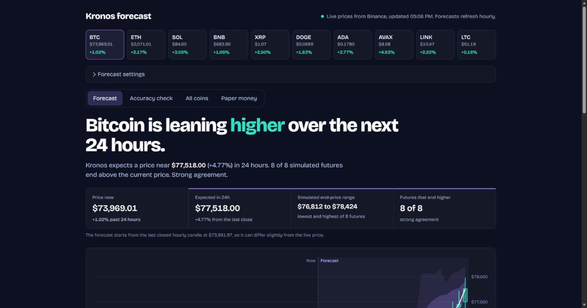
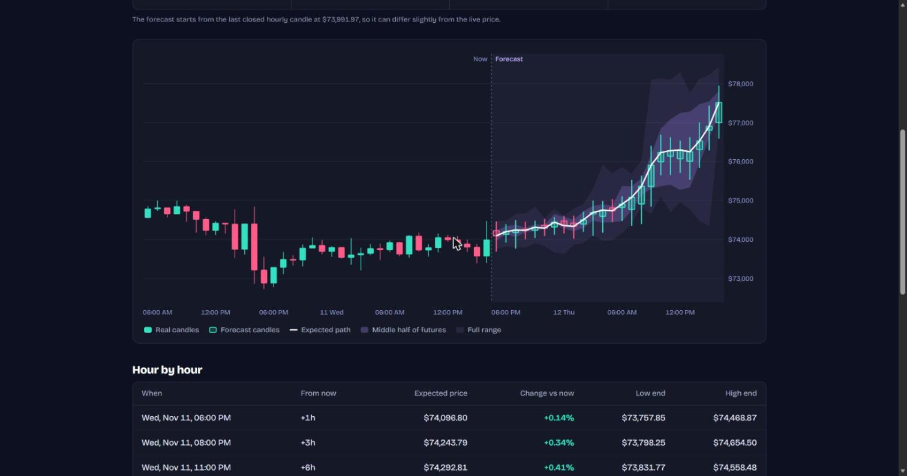
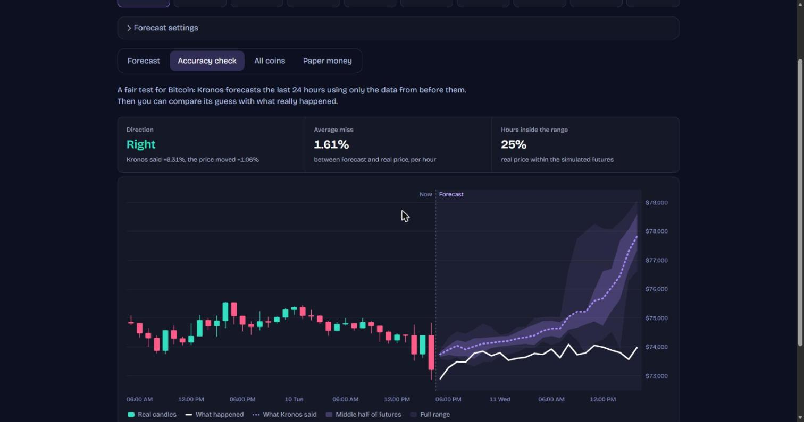
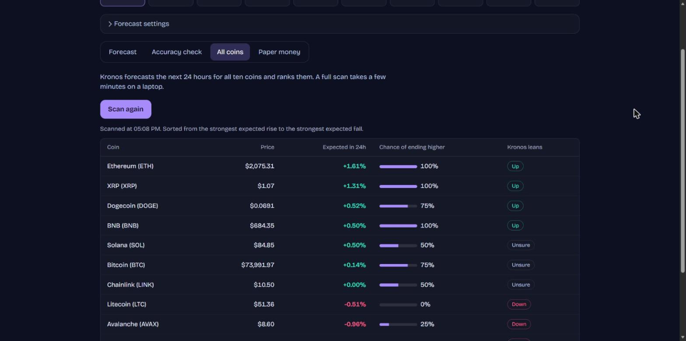
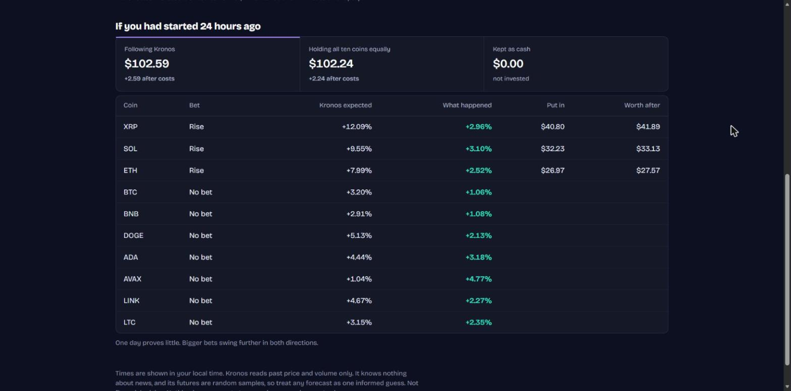

# Kronos Forecast

A web dashboard that forecasts the next 6 to 48 hourly candles for ten major coins with
[Kronos](https://github.com/shiyu-coder/Kronos), an open-source foundation model for candlestick data.

> Experimental. Kronos reads price and volume only, knows nothing about news, and samples random futures.
> In a 7-day backtest it called direction correctly about as often as a coin flip. Nothing here is financial
> advice, and the app never places a real trade.



## What it does

### Forecast

A plain-language verdict, the expected price, the range of simulated futures, and the predicted candles on a chart
you can hover. Solid candles are real, hollow candles are forecast. The shaded bands show where the simulated futures
landed. It refreshes itself when a new hourly candle closes.



### Accuracy check

Kronos forecasts the last 24 hours without seeing them, next to what really happened. This is the honest view: in
this example it guessed the direction but overshot the size of the move.



### All coins

Scans all ten coins and ranks them by expected move, with how many of the simulated futures agree.



### Paper money

Splits a pretend amount across Kronos's top picks, after trading costs. Replay the last 24 hours or start a live
portfolio that closes after 24 hours. The portfolio is saved in your browser only.



In this example every coin rose, so following Kronos and simply holding came out about the same. Kronos expected
far bigger moves than happened (+12% for XRP against +3%). One day tells you very little.

## Run it

```bash
pip install -r requirements.txt
python server.py
```

Then open http://127.0.0.1:8000. Needs Python 3.10 or newer.

- The first run downloads the model weights from Hugging Face.
- Prices come from Binance's public market-data API. **No account, API key or secret is used or stored.**
- The server listens on `127.0.0.1` only, so other machines on your network cannot reach it. Set `PORT` to change the port.
- It runs on a laptop CPU. One forecast takes up to a minute, and a scan of all ten coins takes a few minutes. A GPU is used automatically if PyTorch can see one.

## How it is built

- `server.py`: a small FastAPI server. It fetches candles, runs Kronos, caches results for an hour and serves the site.
- `web/`: the site itself, in plain HTML, CSS and JavaScript with no framework and no build step. The charts are hand-drawn SVG.
- `model/`: the Kronos model code, unchanged (see Credits).
- `backtest.py`: a command-line replay of the last week.

## Week-long backtest

```bash
python backtest.py 150 7
```

This replays the last 7 days with a budget of 150. Each day it follows Kronos's top three picks for 24 hours and
subtracts 0.3% per round trip for fees and slippage. It compares that with holding all ten coins.

## Credits

The `model/` folder is the Kronos model code, copied unchanged from
[shiyu-coder/Kronos](https://github.com/shiyu-coder/Kronos) under its MIT license (see `model/LICENSE`).
